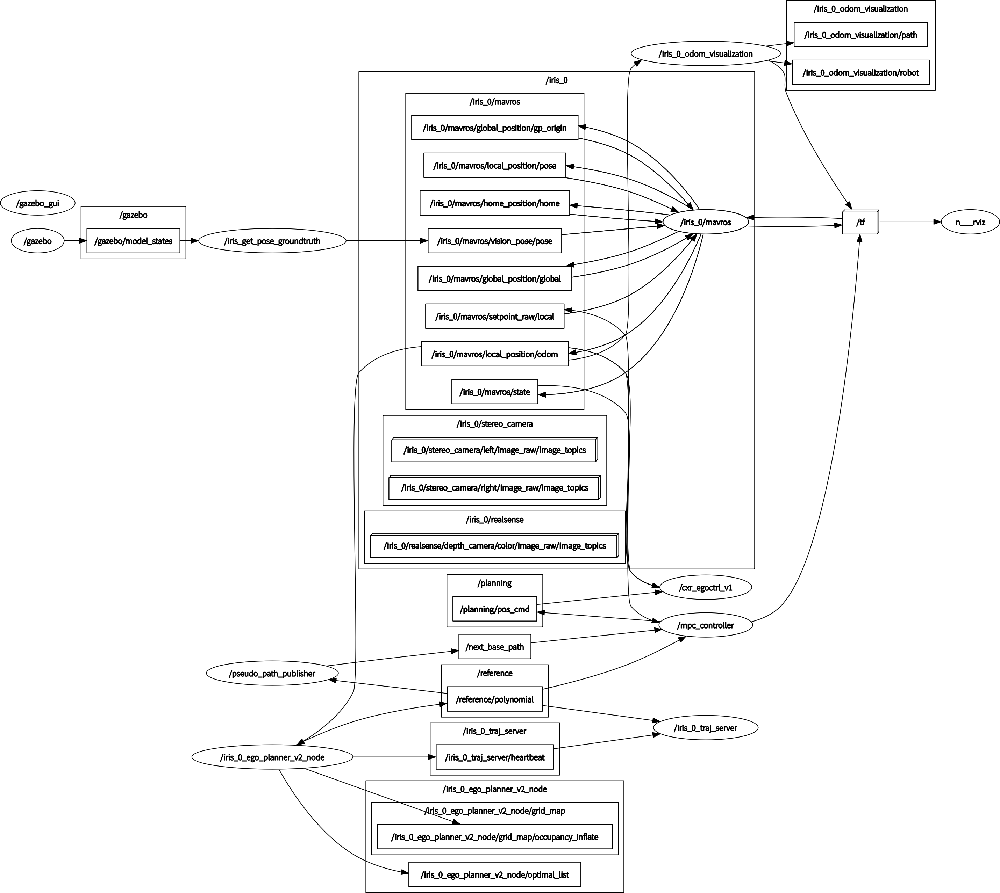

## 无人机MPC控制器使用方法

安装PX4仿真环境[XTDrone](https://www.yuque.com/xtdrone/manual_cn/basic_config_13#);
定位来源设置为24[EKF](https://www.yuque.com/xtdrone/manual_cn/ekf_settings#);
使用定位真值[ground_truth](https://www.yuque.com/xtdrone/manual_cn/pose_groundtruth);

### ego planner
参考对应readme安装依赖

### mpc controller
参考对应readme安装依赖

#### 启动仿真环境

参考视频以及rosgraph：

```
roslaunch px4 indoor5.launch
```
#### 获取定位信息
```
python3 /root/XTDrone/sensing/pose_ground_truth/get_local_pose.py iris 1 
```
#### 启动速度控制器
```
rosrun offboard offb_vel_node 
```
#### 启动MPC控制器并绕八字
```
roslaunch pseudo_path pseudo_path.launch path_num:=3
roslaunch controller mpc_controller_sim.launch
```

#### 性能评估
记录飞行数据后，可使用脚本生成误差曲线并评估响应时间：
```
python3 src/scripts/mpc_performance.py your_record.bag
```
